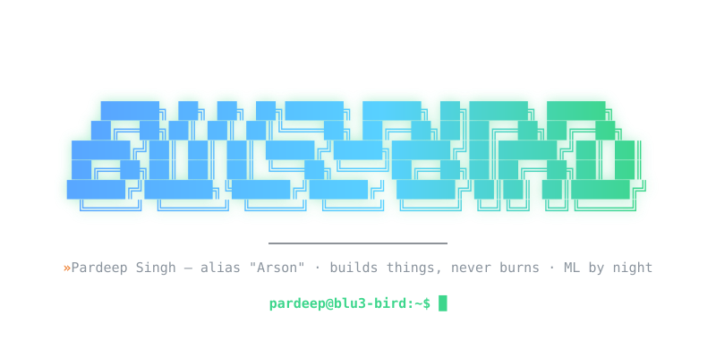
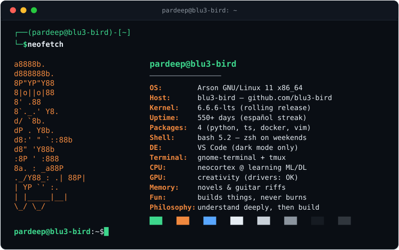
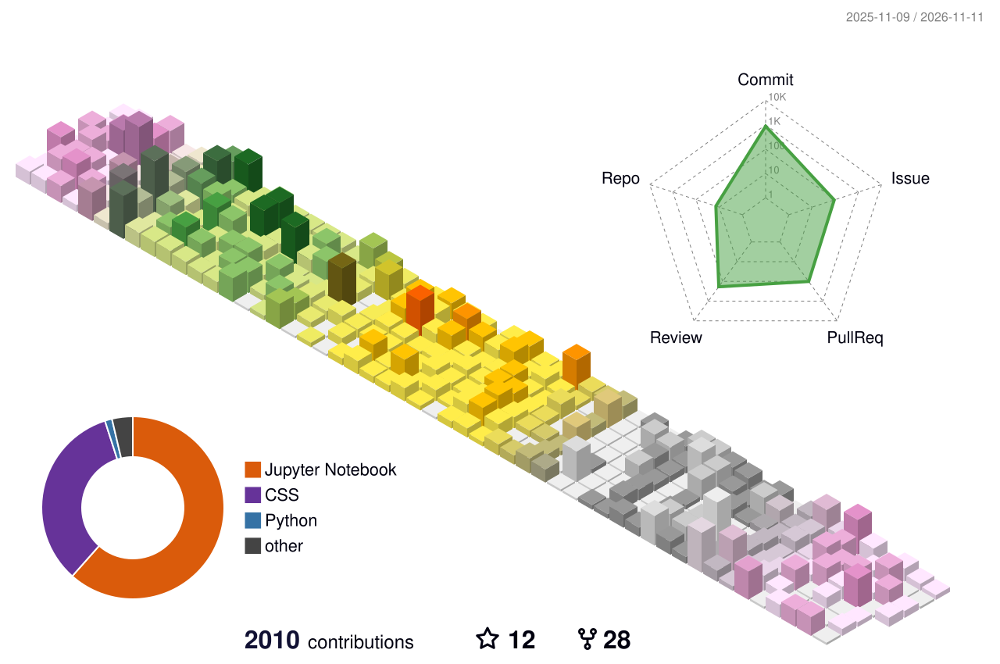

  

---

### `┌──(pardeep@blu3-bird)-[~]`
### `└─$ whoami`

  

### `└─$ tail -f /var/log/life.log`

  

### `┌──(pardeep@blu3-bird)-[~/stack]`
### `└─$ ls -la`

  

### `┌──(pardeep@blu3-bird)-[~/stats]`
### `└─$ htop --github`

  
  

### `┌──(pardeep@blu3-bird)-[~/repo]`
### `└─$ git log --graph --3d`

  <picture>
    <source media="(prefers-color-scheme: dark)" srcset="profile-3d-contrib/profile-green-animate.svg"/>
    <source media="(prefers-color-scheme: light)" srcset="profile-3d-contrib/profile-south-season-animate.svg"/>
    
  </picture>

---

### `┌──(visitor@git)-[~]`
### `└─$ ssh pardeep@blu3-bird`

  
  &nbsp;
  
  &nbsp;
  
  &nbsp;
  
  &nbsp;
  

  

<i>Made with 🐧, ❤️, Python &amp; <code>vim</code> — <code>:wq</code></i>

